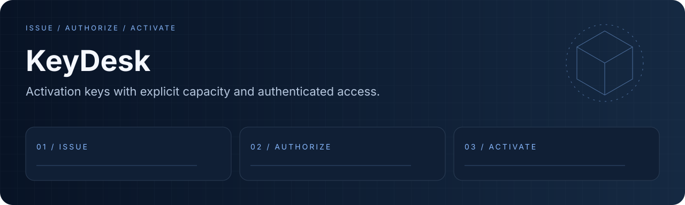

<div align="center">
  
  <h1>KeyDesk</h1>
  <p><strong>让激活码名额、有效期与访问权限都有明确约束。</strong></p>
  <p><a href="LICENSE"></a> <a href="docs/readme/validation.md"></a></p>
  <p><a href="#overview">项目亮点</a> · <a href="#quick-start">快速开始</a> · <a href="#workflow">工作流</a> · <a href="#validation">验证</a> · <a href="#documentation">文档</a></p>
  <p><a href="README.en.md">English</a> · <a href="README.md">简体中文</a></p>
</div>

---

<a id="overview"></a>
## 项目亮点

Go/PostgreSQL 激活码服务与可复用库，提供账号认证、激活码生成和事务内激活记录。

| 能力 | 内容 |
| :--- | :--- |
| **激活码生命周期** | 类型、到期、名额、校验与撤销。 |
| **认证 API** | 必须有到期时间的 HS256 token 与管理员生成权限。 |
| **原子激活** | 名额占用与激活记录在同一事务内完成。 |

<a id="quick-start"></a>
## 快速开始

```bash
git clone https://github.com/eust-w/keydesk.git
cd keydesk
# Go 1.24+ and PostgreSQL are required.
go mod download
cp config/config.example.yaml config/config.yaml
# Set your database connection and a random JWT secret in config/config.yaml.
go run ./cmd/server
```

管理员账号需由数据库管理员明确授予角色；公开注册仅创建普通用户。创建 PostgreSQL 数据库后，将连接信息和随机 secret 写入配置。示例角色提升：

```sql
UPDATE users SET role = 'admin' WHERE email = 'YOUR_ADMIN_EMAIL';
```

<a id="workflow"></a>
## 工作流

```text
ISSUE → AUTHORIZE → ACTIVATE
```

```bash
go test -race ./...
go build ./cmd/server
# PostgreSQL acceptance in a disposable database:
KEYDESK_TEST_POSTGRES_DSN='host=127.0.0.1 user=YOUR_USER dbname=YOUR_TEST_DB sslmode=disable' go test -race ./...
```

<a id="validation"></a>
## 验证

```bash
go test -race ./...
go build ./cmd/server
```

运行环境与已执行结果见 [validation notes](docs/readme/validation.md).

| 项目 | 当前边界 |
| :--- | :--- |
| 升级行为 | 无 exp 的旧 token 会失效，需要重新登录。jwt.expires_in 使用正的 Go duration，默认 24h。 |
| API | 注册默认普通用户；生成激活码需要管理员角色。 |
| 公共库 | 使用已编译示例中的 request struct 接口，旧位置参数示例已过时。 |

<a id="documentation"></a>
## 文档

- [Compiled package example / 公共库示例](examples/basic_usage.go)
- [Activation logic / 激活逻辑](pkg/activation/manager.go)
- [Routes / 路由](cmd/server/main.go)

## 许可证与来源

原创代码和新增演示资源采用 [MIT](LICENSE). 第三方代码、模型、数据和外部资源保留各自许可，详见 [THIRD_PARTY_NOTICES.md](THIRD_PARTY_NOTICES.md).
